<picture>
  <source media="(prefers-color-scheme: dark)" srcset="assets/banner-dark.svg">
  
</picture>

  
  
  

## 👋 About me

I'm a Computer Science undergrad and an intern at **Snabbit**. I build **AI agents, machine-learning systems and data products**, and I like projects where the evidence is part of the deliverable: evaluation scripts, ablation studies, confusion matrices and an honest section on what didn't work.

- 🤖 **Agents:** LLM agents that investigate production incidents and mentor developers inside their own repos
- 🧠 **ML:** audio, text and vision classification, and reproducing research papers from scratch
- 📊 **Data:** SQL-first analytics, cohort and RFM analysis, experiment design
- 🛠️ **Fundamentals:** a six-phase compiler that runs entirely in the browser

---

## 🚀 Featured work

### 🤖 AI agents

| Project | What it does | Built with |
|:--|:--|:--|
| [**OnCall Agent**](https://github.com/aman01k/oncall-agent) | Investigates a production alert the way an on-call engineer would. It searches logs, metrics, deploys and runbooks, writes an evidence-backed root-cause report, and can only *propose* a rollback for a human to approve. Scored against three seeded failures and a fixed-pipeline baseline. | Python · LLM tool use · Streamlit |
| [**DevMentor**](https://github.com/aman01k/devmentor-ai-agent) | A coding-agent CLI that inspects, plans, explains, executes, validates and *teaches* as it works, with permission and safety policies and pluggable model providers. | Go · Anthropic · OpenAI · Gemini · Ollama · Docker |

### 🧠 Machine learning

| Project | What it does | Built with |
|:--|:--|:--|
| [**Infant Cry State Recognition**](https://github.com/aman01k/infant-cry-state-classification) | Classifies what a baby's cry means from raw audio, built in three phases: classical ML, then a CNN on log-Mel spectrograms, then a hybrid model fusing the CNN with 70 acoustic features. Trained on 1,197 real recordings. | TensorFlow · librosa · scikit-learn |
| [**SupportSense**](https://github.com/aman01k/Support_Sense) | Triage for customer-support tickets: category (99.6% accuracy across 11 classes), sentiment, urgency, team routing and reply deadlines, shown in a dashboard. Team project. | scikit-learn · VADER · SQLite · Streamlit |
| [**Dual Coordinate Descent**](https://github.com/aman01k/dual-coordinate-descent-logistic-regression) | From-scratch reproduction of Yu, Huang & Lin (2011) for logistic regression, with an L-BFGS comparison, ablations and a failure-mode study. | NumPy · Jupyter |
| [**Computer Vision Projects**](https://github.com/aman01k/Computer-Vision-Projects) | Real-time object, vehicle and pedestrian detection, plus facial expression recognition. | OpenCV · Keras |

### 📊 Data & analytics

| Project | What it does | Built with |
|:--|:--|:--|
| [**Foodlytics**](https://github.com/aman01k/foodlytics) | Growth analytics on about 100k real e-commerce orders: a PostgreSQL KPI layer, cohort and RFM analysis, and an A/B-test simulator showing a 10% discount would need a +263% conversion lift just to break even. | SQL · PostgreSQL · pandas · Streamlit |

### 🛡️ Security & systems

| Project | What it does | Built with |
|:--|:--|:--|
| [**NetGuard**](https://github.com/aman01k/NetGuard-AI-Driven-Real-Time-Network-Threat-Monitor) | Real-time intrusion detection: live packet capture, Isolation Forest anomaly detection and a threat dashboard. | Scapy · scikit-learn · Plotly · Streamlit |
| [**Turtle Graphics Compiler**](https://github.com/aman01k/Turtle-Graphics-Compiler) | Lexer → parser → semantic analysis → IR → optimizer → SVG code generation, with every phase visualized live as you type. Zero dependencies. | JavaScript · Compiler design |

<b>🌐 Web development</b>

 

| Project | What it does | Built with |
|:--|:--|:--|
| [**Airbnb clone**](https://github.com/aman01k/Airbnb) | Full-stack listings, multi-step creation, maps, calendars and reservations | Next.js 14 · Supabase · Prisma · Kinde |
| [**Hotel Booking UI**](https://github.com/aman01k/Hotel-Booking_website) · [live](https://hotel-booking-website-sigma.vercel.app) | Property search, category filters and image carousels | React · Material UI |
| [**Task Manager API**](https://github.com/aman01k/Task-Manager) | REST API with JWT auth and task CRUD | Node.js · Express · MongoDB |
| [**Chroma Webstore**](https://github.com/aman01k/Chroma-Webstore) | Electronics storefront with product pages and auth | React · Tailwind |

---

## 🧰 Toolbox

**Languages** 

**AI & machine learning** 

**Apps & data** 

**Shipping** 

---

  <b>Working on something in AI agents, ML or data?</b> I'm always happy to talk. Reach me on <a href="https://www.linkedin.com/in/aman01kk">LinkedIn</a>.

